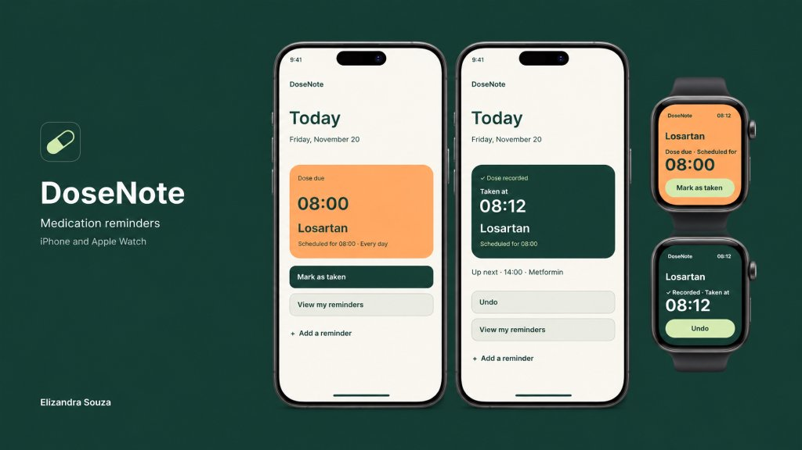
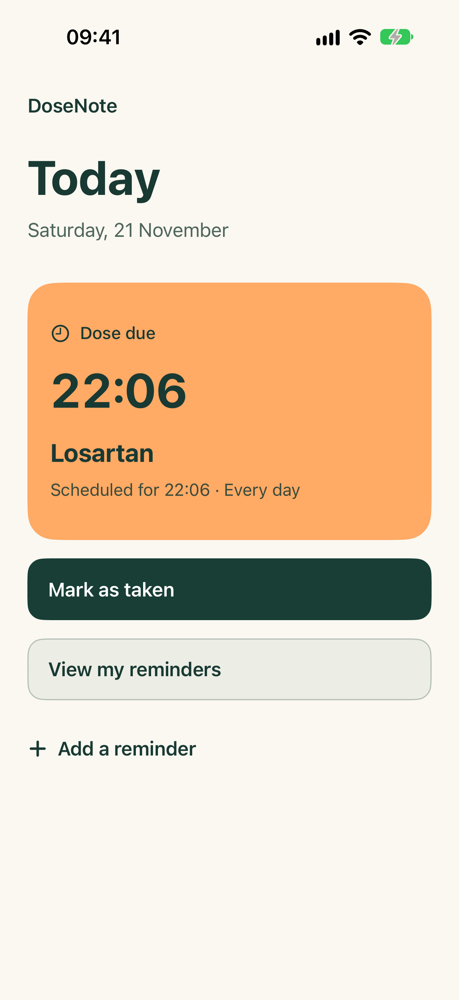
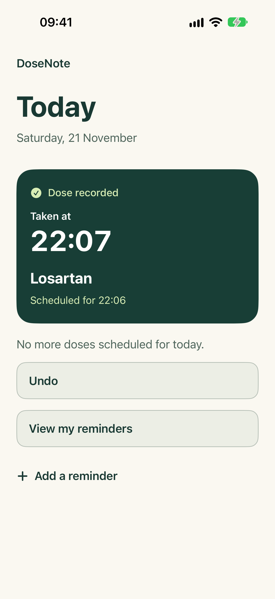
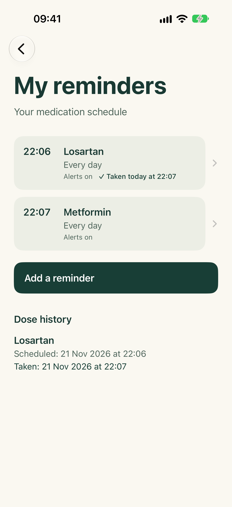
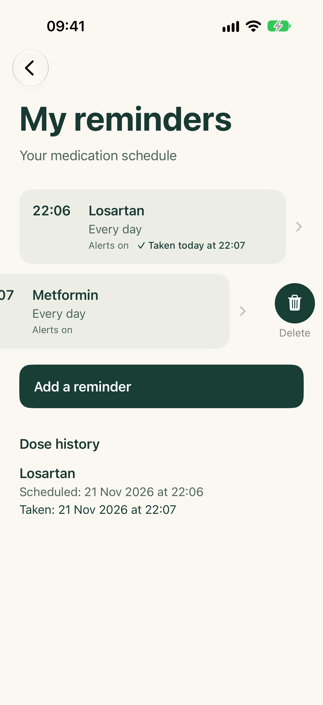
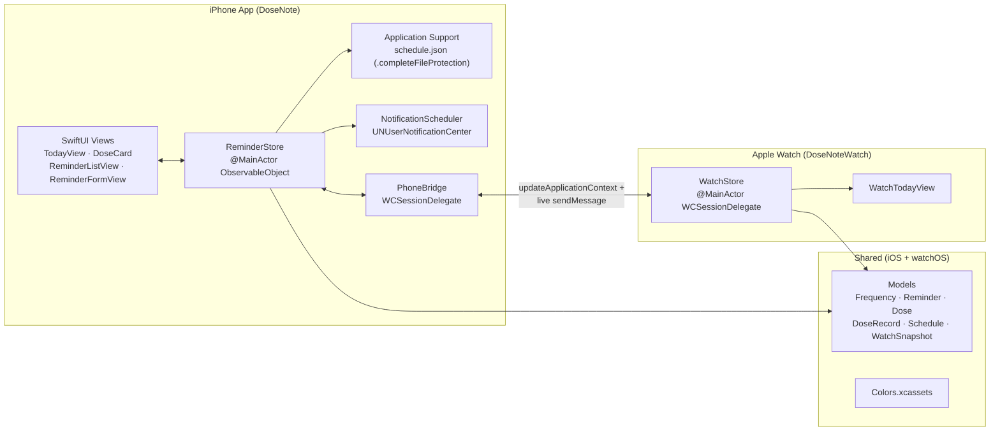

<p align="center">
  
</p>

# DoseNote

A calm, focused medication reminder app for **iPhone** and **Apple Watch**, built natively with SwiftUI, `UserNotifications`, and `WatchConnectivity`.

DoseNote centers on one daily screen (`Today`) that answers a single question at a glance: *do I need to take a medication right now, or have I already taken it?*

**Platforms:** iOS 17.0+ · watchOS 10.0+  
**Stack:** Swift 5 · SwiftUI · Combine · UserNotifications · WatchConnectivity · XCTest

---

## Preview

<table>
  <tr>
    <td align="center" width="25%">
      <br />
      <sub><strong>Today · Dose due</strong></sub>
    </td>
    <td align="center" width="25%">
      <br />
      <sub><strong>Today · Dose recorded</strong></sub>
    </td>
    <td align="center" width="25%">
      <br />
      <sub><strong>My reminders &amp; history</strong></sub>
    </td>
    <td align="center" width="25%">
      <br />
      <sub><strong>Safe swipe-to-delete</strong></sub>
    </td>
  </tr>
</table>

---

## Features

- **Single-focus Today flow:** Highlights the due, recently recorded, or next upcoming dose with clear visual hierarchy between primary (`Mark as taken`) and secondary (`Undo`, `View my reminders`) actions.
- **Semantic color system:** Shared across iPhone and Apple Watch (`Due` warm amber for pending doses, `Forest` green for confirmed intake, `Mint` for upcoming schedules and Watch actions).
- **Companion Apple Watch app:** Displays the featured dose on the wrist and syncs intake confirmations directly with the iPhone via `WatchConnectivity`.
- **Flexible schedules:** Supports daily, every 12 hours, and weekly reminders with per-reminder notification toggles and safe swipe-to-delete (`allowsFullSwipe: false`).
- **Accessibility:** Dynamic Type scaling (`@ScaledMetric`), tabular numerals (`.monospacedDigit()`), VoiceOver header traits, and combined card semantics.

---

## Architecture



### Project Structure

```text
DoseNote/
├── Shared/
│   ├── Models/            # Pure value types: Frequency, Reminder, Dose, Schedule, WatchSnapshot
│   └── Resources/         # Colors.xcassets compiled into both iOS and watchOS targets
├── DoseNote/
│   ├── App/               # DoseNoteApp entry point and scenePhase refresh
│   ├── DesignSystem/      # DosePage, PageHeading, Primary/Secondary ButtonStyle, doseField
│   ├── Store/             # ReminderStore (persistence) and SampleData for SwiftUI #Preview
│   ├── Services/          # NotificationScheduler and PhoneBridge (WatchConnectivity)
│   └── Features/
│       ├── Today/         # TodayView and DoseCard
│       └── Reminders/     # ReminderListView and ReminderFormView
├── Watch/                 # DoseNoteWatchApp, WatchStore, WatchTodayView
├── DoseNoteTests/         # Deterministic unit tests for Schedule and Dose logic
└── docs/images/           # Simulator screenshots used in documentation
```

---

## Key Engineering Decisions

- **Calendar-stable dose identifiers (`Dose.makeID`):** Dose IDs are built from local calendar components (`<reminderID>-YYYY-MM-DD-HH-mm`) rather than Unix timestamps (`timeIntervalSince1970`), preventing recorded doses from drifting across time zone changes or Daylight Saving Time transitions.
- **Single source of truth for dose history (`DoseRecord`):** Recorded intakes store an immutable snapshot (`medicationName`, `scheduled`, `taken`) inside `Schedule.records`, eliminating duplicated state while preserving past logs if a reminder is later edited or deleted.
- **iOS 64-notification guard & race-free reconciliation:** `ReminderStore` validates active alert slots against iOS's 64 pending local notification limit before committing, and `NotificationScheduler` reconciles `"dose."`-prefixed triggers idempotently using a monotonic `revision` counter.
- **Dual-channel `WatchConnectivity`:** Uses `updateApplicationContext` to keep the latest `WatchSnapshot` available in the background and `sendMessage(_:replyHandler:)` for live dose confirmation, keeping the iPhone as the single source of truth.
- **On-device privacy without unnecessary friction:** Schedules are written atomically to `Application Support` with `.completeFileProtection` (hardware-encrypted when locked), allowing the app to open straight into `Today` without an artificial splash delay or an offline account wall.

---

## Running & Testing

### Requirements
- Xcode 16+
- iOS 17.0+ / watchOS 10.0+

### Run the app
1. Open `DoseNote.xcodeproj` in Xcode.
2. Select the **`DoseNote`** (iPhone) or **`DoseNoteWatch`** (Apple Watch) scheme.
3. Press **`Cmd + R`** to run in the Simulator (or open any SwiftUI view to inspect `#Preview` states in the Canvas).

### Run unit tests
Press **`Cmd + U`** in Xcode to execute `DoseNoteTests/ScheduleTests.swift`.  
All 7 unit tests inject a fixed UTC `Calendar` and cover:
- First-day boundary handling for daily and every-12-hour schedules
- Weekly weekday matching
- `featured(at:keepingRecorded:)` priority rules
- Time-zone stability of `Dose.makeID`
- Active alert slot counting (including paused and 12-hour reminders)
- `Schedule` `Codable` round-trip integrity

---

## Author & Copyright

Created by **Elizandra Souza**.

© 2026 Elizandra Souza. All Rights Reserved.  
This repository is publicly available for **portfolio review and recruitment evaluation**. Redistribution, commercial use, or derivative publication without prior written permission is not permitted.
